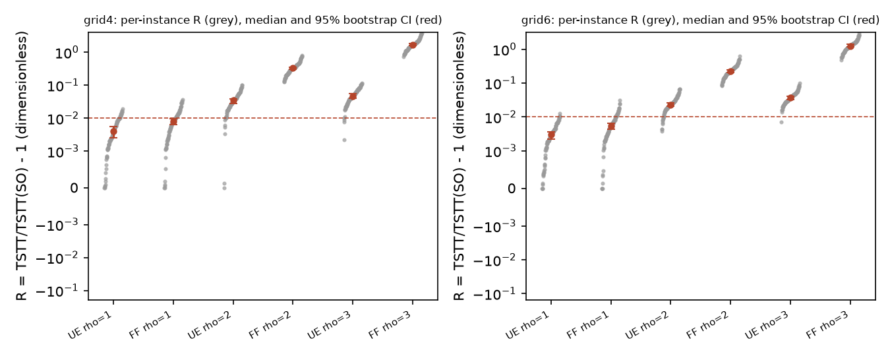

<!-- SPDX-License-Identifier: LicenseRef-FLOW-NC-Research-1.0 -->
# EXP-003: Grid networks, collective excess of individually optimal routing (primary) (report)

## 1. Identification

- Experiment EXP-003, the primary experiment. Report date 2026-11-25. Report version 1.0.
- **Status: CONFIRMATORY, complete (2,900 records). Primary verdict: H0 REJECTED, theta > 0.01.**
- Authorship: Mohamed Bechir Kefi, independent researcher (owner-approved; owner, 2026-11-26, decision sheet, B3). An AI assistant (Claude) is disclosed and is not an author.
- Protocol sha256 `b047a0b1ed00d0f8b464be83d6204f49970839522bcec3803529c7b507353eba`. Umbrella protocol v1.0, sha256 `9f629b07...b97d`.
- Config `experiments/EXP-003.json`, file sha256 `51ad8fa44ae3d05e6132a7336b7f7e84fb2aee9855a3921f3db06720cbac8367`; canonical hash `6cbcaa47d6d0bfb800ecf8ff79398cd40275cf08124f682dab377d0df7bc7c4a`.
- Provenance revision `8dfc66ca5c9635e160f38526843941716aadacd0`.
- The manifest says `dirty: true` because of untracked analysis outputs of other experiments written during the run. No tracked file differed (D-014, deviation 1).
- Composed under owner approvals item 4 (D-015).

## 2. Executive summary

**Question.** On seeded BPR grids, by how much does the total travel time of individually optimal routing (UE, and the FF baseline) exceed the system optimum?

**Method.** 100 instances per grid size (4x4 seeds 1000-1099; 6x6 seeds 2000-2099) at demand levels rho = 1, 2 and 3. Arms FF, UE and SO, with UE and SO solved by gradient projection at `RG <= 1e-6`. Sensitivity cells S1, S2 and S3 on the 6x6, rho = 2 cell. Primary rule: reject H0 (theta <= 0.01) if the one-sided 95 percent percentile-bootstrap lower bound of the median R(UE) exceeds 0.01.

**Outcome.**

- Median R(UE) = 0.02317 over n = 100 instances, none excluded.
- One-sided 95 percent lower bound 0.02134; two-sided 95 percent CI [0.02075, 0.02559].
- H0 is rejected.
- The decision is unchanged at tolerances 1e-4 and 1e-8 and under the absolute demand calibration (S3).

**Principal caveats.**

- With linear-in-flow costs (S2, beta = 1) the median falls to 0.00304, below delta.
- The Frank-Wolfe reference converged on only 7 of 100 instances.
- Exploratory values of this cell's analogue were seen before the freeze (C4, `research/freeze.json`).

## 3. Research rationale and literature

- Roughgarden and Tardos (2002, preprint read): the ratio is at most 4/3 for linear latencies and unbounded for general latencies.
- Youn et al. (2008, arXiv version 4 read in full at M6): city networks show a measurable gap.

This experiment measures the gap in a controlled synthetic family, with paired uncertainty.

## 4. Hypotheses and operational definitions

- `R(arm) = TSTT(arm) / TSTT(SO) - 1` on the same instance and level; dimensionless.
- Primary estimand theta: the median of R(UE) over 6x6 instances at rho = 2. H0: theta <= 0.01. H1: theta > 0.01.
- Interval method: percentile bootstrap over instances, 10,000 resamples, seed 20261124.
- Exclusion: an instance is excluded if UE or SO did not converge. If more than 10 percent of the primary cell is excluded, the analysis is reported as failed.
- Secondary (descriptive, no test):
  - the paired difference R(FF) - R(UE) at each size and level;
  - paired fairness (Gini of the stretch) and p95 trip-time differences.

## 5. Methodology

- **Grid generator.** grid-v1: t0 ~ U[1, 3] min, capacity ~ U[600, 1800] veh/h, 12 OD pairs, Dirichlet weights.
- **Costs.** BPR alpha = 0.15, beta = 4, fitted from TNTP Sioux Falls (J-0010).
- **Demand.** rho x D_ref, the free-flow calibration of protocol section 10.
- **Solvers.** Gradient projection, cap 20,000 sweeps.
- **Sensitivity cells (6x6, rho = 2, seeds 2000-2099):**
  - S1: tolerances 1e-4 and 1e-8, plus a Frank-Wolfe reference at 1e-6 that is not used in any decision;
  - S2: beta = 1;
  - S3: absolute calibration with share s = 0.10826 (J-0011).
- **Hardware.** Apple M1 Pro, Python 3.12.1, numpy 2.5.4.
- **Analysis.** `flow.confirmatory.analyse_exp003`, written and tested before the run (D-012).

## 6. Implementation verification

- The test suite passed before the runs (138 passed).
- The smoke run and metric validation passed (J-0013 to J-0015).
- Invariant checks on every record: flow conservation, and R(SO) = 0.
- The EXP-004 identity check confirms that MIX(0) reproduces this experiment's UE TSTT exactly on all 100 instances: maximum relative difference 0.0.

## 7. Execution record

- Command: `nice -n 10 .venv/bin/flow run EXP-003` (log `results/raw/logs/worker-B.log`).
- Run id `EXP-003-20261124T234531Z-6cbcaa47`.
- Started 2026-11-24T23:45:32Z and finished 2026-11-25T00:22:35Z (UTC). 2,222.8 s. Peak RSS 57 MiB.
- Records: 2,900 planned and 2,900 written: 2,745 ok, 155 nonconverged, 0 failed.
- All nonconverged records are in the Frank-Wolfe reference cell: SO 93, UE 62. They are kept in the raw results.
- No dropped run and no retry.
- Deviations:
  - The dirty flag (D-014, deviation 1).
  - The sensitivity figure's code was changed after output existed, to draw the announced delta line and to stop the title clipping. No estimand, interval or table changed (D-014, deviation 2).

## 8. Results

**Primary (grid6, rho = 2, UE)**

| Statistic | Value |
|---|---|
| Instances, excluded | 100, 0 |
| n used | 100 |
| Median R(UE) | 0.02317 |
| Mean | 0.02575 |
| Quartiles | 0.01732 to 0.03160 |
| Range | 0.00386 to 0.06667 |
| One-sided 95% lower bound | 0.02134 |
| Two-sided 95% CI | [0.02075, 0.02559] |

**Verdict.** H0 rejected (0.02134 > 0.01). The upper bound is not below 0.01, so the loss is not "practically negligible".

**By size and level** (median and 95% bootstrap CI; n = 100 each; every arm converged in every cell)

| Size | rho | R(UE) | R(FF) | Paired R(FF) - R(UE) |
|---|---|---|---|---|
| 4x4 | 1 | 0.00409 [0.00253, 0.00553] | 0.0081 [0.0063, 0.0098] | 0.0008 [0.0000, 0.0025] |
| 4x4 | 2 | 0.03479 [0.02785, 0.03803] | 0.3324 [0.3054, 0.3436] | 0.2951 [0.2654, 0.3210] |
| 4x4 | 3 | 0.04538 [0.04082, 0.05448] | 1.6884 [1.5706, 1.8056] | 1.6332 [1.5038, 1.7480] |
| 6x6 | 1 | 0.00305 [0.00223, 0.00361] | 0.0053 [0.0044, 0.0066] | 0.0005 [0.0000, 0.0015] |
| 6x6 | 2 | 0.02317 [0.02075, 0.02559] | 0.2275 [0.2078, 0.2498] | 0.2007 [0.1782, 0.2202] |
| 6x6 | 3 | 0.03744 [0.03295, 0.04152] | 1.2372 [1.1569, 1.3924] | 1.2101 [1.1188, 1.3400] |

**Paired fairness and p95, UE minus SO** (median [95% CI]; descriptive)

| Size | rho | Gini of stretch | p95 trip time (min) |
|---|---|---|---|
| 4x4 | 1 | 0.00081 [0.00037, 0.00146] | -0.0004 [-0.0040, 0.0000] |
| 4x4 | 2 | 0.00472 [0.00314, 0.00635] | -0.0273 [-0.0561, 0.0002] |
| 4x4 | 3 | 0.00183 [0.00042, 0.00654] | -0.1296 [-0.2089, -0.0143] |
| 6x6 | 1 | 0.00055 [0.00034, 0.00119] | 0.0000 [-0.0002, 0.0002] |
| 6x6 | 2 | 0.00408 [0.00279, 0.00488] | 0.0000 [-0.0171, 0.0263] |
| 6x6 | 3 | 0.00472 [0.00181, 0.00595] | 0.0360 [-0.0223, 0.0954] |

**Sensitivity (6x6, rho = 2)**

| Cell | n used (excluded) | Median R(UE) | One-sided LB | Two-sided 95% CI | Decision | Same as primary |
|---|---|---|---|---|---|---|
| S1 tol 1e-4 | 100 (0) | 0.02305 | 0.02131 | [0.02057, 0.02552] | reject | yes |
| S1 tol 1e-8 | 100 (0) | 0.02317 | 0.02134 | [0.02075, 0.02559] | reject | yes |
| S2 beta = 1 | 100 (0) | 0.00304 | 0.00274 | [0.00264, 0.00360] | not reject | no |
| S3 absolute calibration | 100 (0) | 0.02136 | 0.01847 | [0.01781, 0.02369] | reject | yes |
| S1 Frank-Wolfe reference (not in any decision) | 7 (93) | 0.01407 | 0.00981 | [0.00981, 0.02904] | n/a | n/a |

- Paired change against the primary values:
  - at 1e-4: median -9.9e-6, CI [-3.5e-5, 1.0e-5];
  - at 1e-8: median 5.3e-12, CI [-9.3e-8, 2.5e-7].
- In S3, R(FF) has median 0.2111, CI [0.1832, 0.2835].
- Mean runtime per solve, 6x6 at rho = 2: UE 0.022 s, SO 0.049 s.

**Figures**

- `figures/exp003_R_by_cell.png`.

{width=100%}

  - Caption: "Per-instance R (grey dots), with the median and 95% bootstrap CI (red) for UE and FF by demand level, 4x4 (left) and 6x6 (right); symmetric-log axis; dashed line delta = 0.01; n = 100 instances per point."
  - Alt text: "Strip plots; UE medians are a few percent, FF grows to above 1 at rho = 3."
- `figures/exp003_sensitivity.png`.

{width=100%}

  - Caption: "Median R(UE) with 95% bootstrap CI in the primary cell and each sensitivity cell; Frank-Wolfe reference on its 7 converged instances only; dashed delta = 0.01."
  - Alt text: "All cells except S2 lie above the dashed line."

**Expected versus observed.**

- Expected: a positive UE excess growing with congestion.
- Observed: the median R(UE) in the primary cell is 2.3 percent of the system-optimal travel time, above the 1 percent margin with its whole interval. It grows with rho at both sizes. FF is far worse than UE once demand is congested, but close to UE at rho = 1.

## 9. Interpretation

- **Supported.** In this synthetic family, at BPR curvature beta = 4, equilibrium routing exceeds the system optimum by more than the pre-specified practical margin. The primary finding is robust to solver tolerance (S1: shifts below 4e-5) and to the demand-calibration rule (S3).
- **Scope limit.** With beta = 1 (S2) the excess is 0.3 percent, below delta. The size of the effect depends on cost curvature, consistent with the 4/3 bound for linear latencies being far from reached.
- **Frank-Wolfe reference.** It gives no independent check: 93 of 100 instances did not converge within 20,000 iterations. Its 7 converged values are lower and wide.
- **Baseline.** The FF baseline shows that ignoring congestion altogether costs far more than the equilibrium inefficiency.
- **Fairness and p95.** UE raises the Gini of the stretch slightly over SO at every level, with every interval above 0. p95 differences are small, and both signs occur.
- **Caution.** The assistant saw exploratory analogue values before the freeze (median 0.02349, seeds 9000-9019; C4). The confirmatory instances are disjoint, and the rule was frozen before them.

## 10. Threats to validity

- **Internal.** Solver tolerance (checked by S1). The dirty provenance flag (only untracked files).
- **Construct.** R depends on the demand-calibration definition (checked by S3) and on cost curvature (S2).
- **External.** Synthetic lattice family. 12 OD pairs. Static deterministic assignment with perfect information. No real driver behaviour or city is implied.
- **Statistical.** 100 independent instances per cell. Bootstrap percentile intervals. Secondary contrasts are descriptive and not multiplicity-controlled.

## 11. Conclusion and next experiment

- On 6x6 BPR grids at rho = 2, individually optimal (equilibrium) routing increases total travel time over the system optimum by a median of 2.3 percent: one-sided 95 percent lower bound 2.13 percent, above the 1 percent margin. H0 is rejected.
- The effect depends on cost curvature (S2).
- Next: EXP-004 (compliance), and the real-network test EXP-006.

## 12. Reproduction appendix

See `reproduction.md`. References: Roughgarden, T., Tardos, E. (2002), "How bad is selfish routing?", Journal of the ACM 49(2), 236-259 (preprint read). Youn, H., Gastner, M. T., Jeong, H. (2008), Physical Review Letters 101, 128701 (arXiv:0712.1598v4 read in full at M6).
