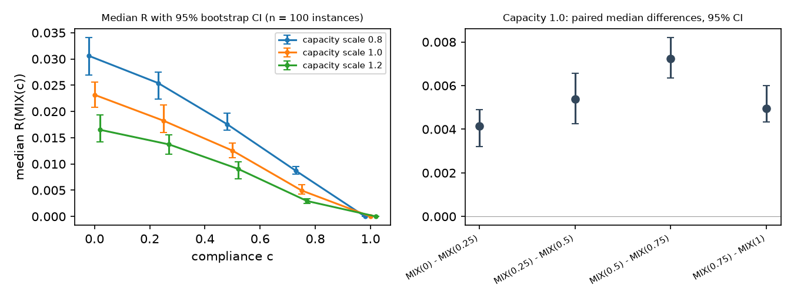

<!-- SPDX-License-Identifier: LicenseRef-FLOW-NC-Research-1.0 -->
# EXP-004: Compliance and capacity sweep (report)

## 1. Identification

- Experiment EXP-004. Report date 2026-11-25. Report version 1.0.
- **Status: CONFIRMATORY, complete (2,100 of 2,100 records). Verdict: H1 SUPPORTED. The median R(MIX(c)) decreases strictly at every consecutive compliance step (capacity scale 1.0).**
- Authorship: Mohamed Bechir Kefi (owner-approved). An AI assistant (Claude) is disclosed and is not an author.
- Protocol sha256 `37e8e3281f4be0ce143989bed7acd0efb8a896000e7b4e4bf273bfe048f6de22`.
- Config file sha256 `2e7b98037c5cede97ec570792f70c48ab18f9e4d58d4fe433e92753ead50988c`; canonical hash `7a7c26921a0225fce4d79fe05cfa88b874cc5d0d5926e651fbe818e2da3f7245`.
- Revision `8dfc66ca5c9635e160f38526843941716aadacd0`. The manifest says `dirty: true` because of untracked analysis files only (D-014).
- Composed under owner approvals item 4 (D-015).

## 2. Executive summary

**Question.** How does the collective excess change when a fraction c of travellers follows system-optimal routing, and when every capacity is scaled?

**Method.** The 100 EXP-003 6x6 instances at rho = 2, run for:

- MIX(c) with c in {0, 0.25, 0.5, 0.75, 1};
- capacity scales {0.8, 1.0, 1.2}, with total demand fixed at the scale-1.0 calibration;
- FF and SO at each scale.

Gradient projection solves both the SO reference and the follower UE. A MIX record counts as converged only if both converge (A4).

**Rule.** H1 holds if every consecutive paired median difference `R(MIX(c_k)) - R(MIX(c_k+1))` has a one-sided 95 percent bootstrap lower bound above 0. The confirmatory test uses capacity scale 1.0 (D-012).

**Outcome.**

- At scale 1.0 the medians are 0.02317, 0.01824, 0.01254, 0.00496 and 0. All four lower bounds are positive (0.00343, 0.00442, 0.00652, 0.00445), so H1 is supported.
- The same holds at scales 0.8 and 1.2 (descriptive).

**Caveat.** The protocol's item 17 sensitivity (link-flow instead of path-flow compliant scaling) has no frozen config and was not run. Whether to add it is the owner's decision.

## 3. Research rationale and literature

Partial central control is studied in Stackelberg routing (Roughgarden 2004) and mixed behaviour classes (Harker 1988). Both are verified at the metadata level only and are not cited as read.

## 4. Hypotheses and operational definitions

- **MIX(c).** A share c of each OD demand follows the SO path flows scaled by c. The rest reaches UE with the compliant flow as fixed background.
- **Identity checks.** MIX(0) = UE and MIX(1) = SO.
- **H1.** The median R(MIX(c)) decreases strictly with c.
- **H0.** Some consecutive pair has a 95 percent lower bound at or below 0. D-012 reads this as one-sided, with no multiplicity correction: H1 needs all four steps (an intersection-union test).
- **Capacity scale.** Descriptive.
- **Secondary.** The ratio of compliant to non-compliant mean travel times.

## 5. Methodology

- Seeds 2000-2099 (6x6). BPR alpha = 0.15, beta = 4.
- R is computed relative to SO at the same capacity scale.
- The compliant flow uses the deterministic gradient-projection SO path flows.
- Bootstrap: 10,000 resamples, seed 20261124, paired by instance.
- Analysis: `flow.confirmatory.analyse_exp004`, written before the run.

## 6. Implementation verification

- The test suite passed before the runs (138 passed).
- In this run, MIX(1) has R = 0 exactly on every instance and scale.
- MIX(0) reproduces the EXP-003 grid6 rho = 2 UE TSTT on all 100 instances: maximum relative difference 0.0.

## 7. Execution record

- Command: `nice -n 10 .venv/bin/flow run EXP-004` (log `results/raw/logs/worker-B.log`).
- Run id `EXP-004-20261125T002235Z-7a7c2692`.
- Started 2026-11-25T00:22:35Z and finished 00:22:53Z (UTC). 18.4 s. Peak RSS 55 MiB.
- Records: 2,100 planned (100 instances x 3 scales x 7 arms) and 2,100 written: 2,100 ok, 0 nonconverged, 0 failed. No dropped run and no retry.
- Deviations: the dirty flag (untracked files only). Item 17 sensitivity not run (no frozen config).

## 8. Results

**Median R and 95% bootstrap CI, n = 100 per cell**

| Arm | Capacity 0.8 | Capacity 1.0 | Capacity 1.2 |
|---|---|---|---|
| FF | 0.59239 [0.55147, 0.65693] | 0.22745 [0.20778, 0.24982] | 0.09698 [0.08765, 0.10728] |
| MIX(0) | 0.03058 [0.02698, 0.03411] | 0.02317 [0.02075, 0.02559] | 0.01651 [0.01426, 0.01935] |
| MIX(0.25) | 0.02542 [0.02237, 0.02746] | 0.01824 [0.01605, 0.02124] | 0.01372 [0.01184, 0.01556] |
| MIX(0.5) | 0.01758 [0.01643, 0.01963] | 0.01254 [0.01116, 0.01400] | 0.00907 [0.00715, 0.01043] |
| MIX(0.75) | 0.00868 [0.00809, 0.00950] | 0.00496 [0.00432, 0.00600] | 0.00294 [0.00251, 0.00338] |
| MIX(1) | 0 | 0 | 0 |

**Consecutive paired median differences** (one-sided 95% lower bound; two-sided 95% CI)

| Step | Capacity 0.8 | Capacity 1.0 (confirmatory) | Capacity 1.2 |
|---|---|---|---|
| MIX(0) - MIX(0.25) | 0.00510 (0.00460; [0.00447, 0.00581]) | 0.00415 (0.00343; [0.00322, 0.00489]) | 0.00295 (0.00204; [0.00194, 0.00367]) |
| MIX(0.25) - MIX(0.5) | 0.00684 (0.00592; [0.00581, 0.00770]) | 0.00539 (0.00442; [0.00425, 0.00656]) | 0.00386 (0.00342; [0.00333, 0.00493]) |
| MIX(0.5) - MIX(0.75) | 0.00964 (0.00840; [0.00828, 0.01077]) | 0.00725 (0.00652; [0.00636, 0.00821]) | 0.00571 (0.00470; [0.00447, 0.00667]) |
| MIX(0.75) - MIX(1) | 0.00868 (0.00816; [0.00809, 0.00950]) | 0.00496 (0.00445; [0.00432, 0.00600]) | 0.00294 (0.00255; [0.00251, 0.00338]) |
| All steps pass | yes | yes | yes |

**Compliant to non-compliant mean time ratio** (median [95% CI])

| Arm | Capacity 0.8 | Capacity 1.0 | Capacity 1.2 |
|---|---|---|---|
| MIX(0.25) | 1.0058 [1.0050, 1.0071] | 1.0051 [1.0043, 1.0055] | 1.0037 [1.0033, 1.0046] |
| MIX(0.5) | 1.0091 [1.0080, 1.0103] | 1.0076 [1.0066, 1.0088] | 1.0062 [1.0052, 1.0076] |
| MIX(0.75) | 1.0164 [1.0141, 1.0178] | 1.0132 [1.0120, 1.0144] | 1.0109 [1.0093, 1.0116] |

**Figure** `figures/exp004_compliance.png`.

{width=100%}

- Caption: "Left: median R(MIX(c)) with 95% bootstrap CI against compliance c, for each capacity scale (n = 100). Right: paired median differences between consecutive compliance levels at capacity 1.0, with 95% CI."
- Alt text: "Decreasing curves; all paired differences above zero."

**Expected versus observed.**

- Expected: a strict decrease with c, with possible re-equilibration offsets.
- Observed: a strict decrease at every step and at every scale. The largest single step is 0.5 to 0.75. Compliant travellers' mean trip time is 0.4 to 1.6 percent longer than that of non-compliant travellers.

## 9. Interpretation

- **Supported.** Within this MIX operationalisation, more system-optimal compliance monotonically lowers the collective excess. Re-equilibration of the followers does not cancel the benefit at any step.
- **Agency.** Compliant travellers pay a small personal time penalty relative to the others, which grows with c. This is an agency and fairness consideration, not a finding about real drivers.
- **Capacity.** Lower capacity (0.8) raises every R, and higher capacity lowers it; the descriptive pattern is consistent across scales.
- **Not tested.** Whether the result depends on the path-flow decomposition (item 17) was not tested.

## 10. Threats to validity

- **Construct.** One definition of partial compliance. The SO path decomposition is not unique, and the link-flow alternative was not run.
- **Internal.** The dirty provenance flag (untracked files only).
- **External.** Synthetic 6x6 family, as in EXP-003.
- **Statistical.** Paired bootstrap on 100 instances. The intersection-union test needs no multiplicity correction. Scales 0.8 and 1.2 are descriptive.

## 11. Conclusion and next experiment

- H1 is supported: the median collective excess decreases strictly with compliance (0.0232 at c = 0 to 0 at c = 1), with every step's one-sided lower bound above 0.
- Open item for the owner: the item 17 link-flow sensitivity.

## 12. Reproduction appendix

See `reproduction.md`.
