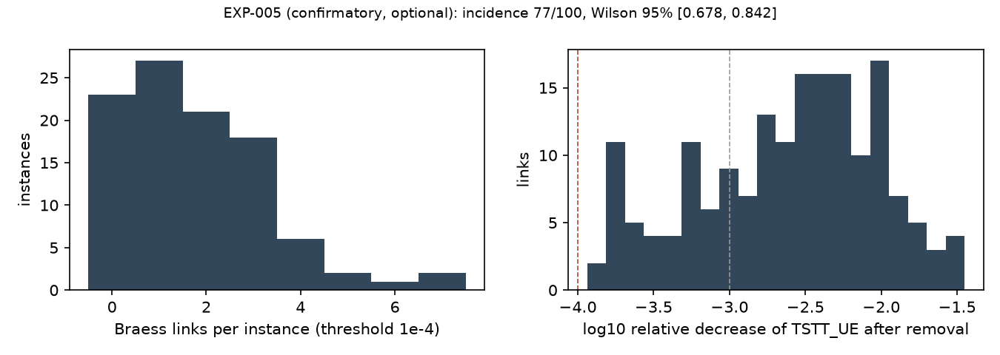

<!-- SPDX-License-Identifier: LicenseRef-FLOW-NC-Research-1.0 -->
# EXP-005 (optional): Single-link removal scan on grids (report)

## 1. Identification

- Experiment EXP-005. **OPTIONAL experiment.** Report date 2026-11-25. Report version 1.0.
- **Status: CONFIRMATORY (optional), complete (5,154 records). Verdict: H1 SUPPORTED. Incidence 77/100 instances, Wilson 95% [0.678, 0.842].**
- Authorship: Mohamed Bechir Kefi, independent researcher (owner-approved; owner, 2026-11-26, decision sheet, B3). An AI assistant (Claude) is disclosed and is not an author.
- Protocol sha256 `e8cb938022b1bc2c41af8712b0a3f26938f43ef84c369a77fd077d7b4fd93359` (frozen 2026-11-24).
- Config `experiments/EXP-005.json`, file sha256 `7b58a93390e30d7f38e4d18899bba77b4dbc841d5d6487536fecbd4e3fca7e0b`, canonical hash `4051f409...`. It was added on 2026-11-25 under the M3 brief as "implements frozen EXP-005, added before any EXP-005 data". It chooses no parameter (D-012), and its FREEZE line is in D-012.
- Revision `8dfc66ca5c9635e160f38526843941716aadacd0`. The manifest says `dirty: true` because of untracked analysis files only (D-014).
- Composed under owner approvals item 4 (D-015).

## 2. Executive summary

**Question.** In 4x4 BPR grids at rho = 2, does removing a single directed link ever reduce UE total travel time (a Braess link)?

**Method.**

1. For each of the 100 EXP-003 4x4 instances (seeds 1000-1099), UE is solved on the full network.
2. UE is then solved with each of the 48 directed links removed in turn, with the demand unchanged.
3. Every removal that lowers TSTT_UE by more than 1e-4 relative is flagged.
4. Each flagged removal is re-solved at `RG <= 1e-8`, together with the full network.

**Outcome.**

- 77 of 100 instances contain at least one Braess link: incidence 0.77, Wilson 95% [0.678, 0.842].
- There are 177 such links. All 177 are confirmed at 1e-8.
- At threshold 1e-3: 67/100 instances, Wilson 95% [0.573, 0.754].

**Caveats.**

- The effects are small: relative decreases range from 1.2e-4 to 0.035.
- A test accidentally executed this config once before the official run; its output was not inspected (D-013).

## 3. Research rationale and literature

- Steinberg and Zangwill (1983) and Valiant and Roughgarden (2010) are verified at the metadata level only.
- Youn et al. (2008, arXiv version 4 read in full at M6; page 4) report street closures that reduce travel time on city networks.

This experiment estimates how often Braess links occur in the EXP-003 grid family.

## 4. Hypotheses and operational definitions

- Incidence: the share of instances with at least one removable link (all OD pairs stay connected) whose removal lowers `TSTT_UE` by more than 1e-4 relative.
- H1: incidence > 0. H0: incidence = 0. Contradiction: no such link in any instance.
- Interval: Wilson 95 percent.
- Also reported:
  - Braess links per instance;
  - the 1e-8 confirmation count (D-012: incidence uses the scan tolerance, and the confirmation is reported alongside);
  - the threshold 1e-3 sensitivity.

## 5. Methodology

- **Network.** 4x4 grid-v1 instances, BPR alpha = 0.15, beta = 4.
- **Demand.** rho = 2, calibrated on the full network and held fixed.
- **Solver.** Gradient projection at 1e-6 and 20,000 sweeps.
- **Removals.** All 48 single directed links. A removal that disconnects an OD pair is skipped and counted.
- **Runner and analysis.** The link-removal runner mode (`flow.runner.run_link_removal`) and the analysis (`flow.confirmatory.analyse_exp005`) were written and tested on exploratory seeds before any EXP-005 data.

## 6. Implementation verification

- Tests cover the runner mode, the skip path, recheck completeness, config validation and known Wilson values.
- The test suite passed before the runs (138 passed).
- Flow conservation holds on every record.

## 7. Execution record

- Command: `nice -n 10 .venv/bin/flow run EXP-005 --quiet` (log `results/raw/logs/worker-A.log`).
- Run id `EXP-005-20261124T234554Z-4051f409`.
- Started 2026-11-24T23:45:54Z and finished 23:46:45Z (UTC). 48.6 s. Peak RSS 91 MiB.
- Records: 5,154 (100 full-network scans, 4,800 removals, and rechecks). All 5,154 ok; 0 nonconverged, 0 failed.
- Skipped (disconnecting) removals: 0. No dropped run and no retry.
- Deviations:
  - D-013: one earlier execution of this config by the test suite, at 2026-11-24T23:38:50Z, from the uncommitted tree, into a pytest temporary directory. It was not inspected and is not used.
  - The dirty flag (untracked files only).

## 8. Results

| Threshold | Instances with a Braess link (n = 100) | Incidence | Wilson 95% | Links in total | Median links per instance |
|---|---|---|---|---|---|
| 1e-4 (primary) | 77 | 0.77 | [0.678, 0.842] | 177 | 1.5 |
| 1e-4, confirmed at RG 1e-8 | 77 | 0.77 | [0.678, 0.842] | 177 | 1.5 |
| 1e-3 (sensitivity) | 67 | 0.67 | [0.573, 0.754] | 128 | 1.0 |

- The largest relative decrease of TSTT_UE after one removal is 0.0354; the smallest flagged one is 1.16e-4.
- Per-instance values: `analysis.json` (`per_instance`).
- Figure `figures/exp005_removals.png`.

{width=100%}

  - Caption: "Left: number of Braess links per instance at threshold 1e-4 (n = 100). Right: log10 of the relative decrease of TSTT_UE for each Braess link, with the 1e-4 (red) and 1e-3 (grey) thresholds."
  - Alt text: "Most instances have zero to three Braess links; effects range from 1e-4 to a few percent."

**Expected versus observed.**

- Expected: incidence > 0.
- Observed: a large majority of instances have at least one Braess link. The flagging was not a tolerance artefact: every flagged link persisted at 1e-8.

## 9. Interpretation

- **Supported.** H1 holds, and Braess links are common in this grid family at rho = 2.
- **Size.** The effects are small: most are below a few percent of TSTT_UE. The protocol gives no materiality threshold beyond 1e-4 and 1e-3, and both are reported.
- **No mechanism claim.** No claim is made about which link types are Braess links; that was not registered.

## 10. Threats to validity

- **Internal.** Solver tolerance (addressed by the 1e-8 recheck). The stray pre-run execution (D-013) did not inform any choice.
- **External.** Synthetic 4x4 family only, rho = 2 only.
- **Statistical.** Wilson interval on 100 independent instances.
- **Construct.** Directed-link removal on a bidirectional lattice is a stylised intervention.

## 11. Conclusion and next experiment

- In 77 of 100 synthetic 4x4 instances, removing one directed link lowers equilibrium total travel time by more than 1e-4 relative (Wilson 95% 0.678 to 0.842).
- All 177 such links are confirmed at a tighter tolerance.
- The effects are at most 3.5 percent.
- Optional experiment: this report is labelled optional.

## 12. Reproduction appendix

See `reproduction.md`.
