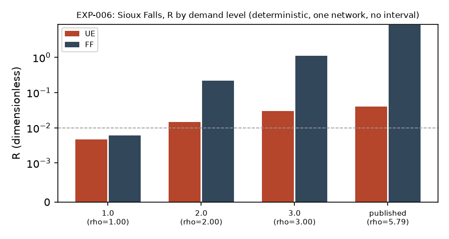

<!-- SPDX-License-Identifier: LicenseRef-FLOW-NC-Research-1.0 -->
# EXP-006: Second test on a real road network (TNTP Sioux Falls) (report)

## 1. Identification

- Experiment EXP-006. Report date 2026-11-25. Report version 1.0.
- **Status: CONFIRMATORY, complete (16 of 16 records). Verdict: validation gate PASSED; the direction REPLICATES, with R(UE) = 0.01453 > 0.01 at rho = 2.**
- Authorship: Mohamed Bechir Kefi (owner-approved). An AI assistant (Claude) is disclosed and is not an author.
- Protocol sha256 `efbca04ab25258af9ae710bc02c09a4e9de4e5f9081ee49444afe284406a37f2`.
- Config file sha256 `a9719a5bdd9e6680be049c4af89a63abae40a3561c89b8f1a9fe7f1488db7d5a`; canonical hash `9a9669c8d4189347263dbd2fddcd979a3b4ce707371be85936cf669e828ebb62`.
- Revision `8dfc66ca5c9635e160f38526843941716aadacd0`. The manifest records `dirty: false`.
- Data manifest sha256 `81470760e8ec9602eef97998833e3f10fd77b2bc22283fce3580c7da1b15e104`.
- Composed under owner approvals item 4 (D-015).

## 2. Executive summary

**Question.** Does the primary direction (equilibrium routing exceeds the system optimum by more than delta = 0.01) hold on one real road network?

**Method.**

- Data: TNTP Sioux Falls, used locally and SHA-256 checked.
- Arms FF, UE and SO by gradient projection at `RG <= 1e-6`.
- Demand levels: the published OD table (rho_SF = 5.788) and the published shares scaled to rho = 1, 2 and 3.
- S1: the published level and rho = 2 re-solved at 1e-8.

**Outcome.**

- Validation gate: the UE link flows at the published demand match the TNTP best-known solution within 1.28e-4 of the largest flow (threshold 1e-3). The gate passes.
- R(UE) at rho = 2 is 0.01453, so the direction replicates. At 1e-8 it is 0.01452.

**Caveat.** One network supports no population claim, and its maintainers describe it as "not considered as a realistic one".

## 3. Research rationale and literature

Sioux Falls (LeBlanc, Morlok and Pierskalla 1975, via the TNTP repository; README read 2026-11-24) is the standard small test network. Its published UE solution allows an external engine check.

## 4. Hypotheses and operational definitions

- Replication: `R(UE) > 0.01` at rho = 2. Contradiction: `R(UE) <= 0.01`.
- Gate, checked first: `max_e |x_e - x_ref_e| / max_e x_ref_e <= 1e-3`. If it fails, EXP-006 is reported as failed.
- Descriptive: R(UE) and R(FF) at the published level and at rho = 1 and 3.
- Units: TNTP times are in 0.01 h. R is dimensionless.

## 5. Methodology

- **Network.** 24 nodes, 76 links, 528 positive OD pairs.
- **Costs.** BPR with b = 0.15 and power 4 for every link.
- **Demand calibration.** As in protocol section 10, with the published OD shares: D_ref = 62,301.9.
- **Data.** From pinned commit `d1639b4e...`, checked against `data/manifest.json` before loading. Licence "academic research purposes only"; never redistributed.
- **Analysis.** `flow.confirmatory.analyse_exp006`, written before the run.

## 6. Implementation verification

- Ingestion tests: `tests/test_tntp.py`.
- Pre-freeze engine check: J-0012, UE only.
- The test suite passed before the runs (138 passed).
- The gate itself is the external check in this run.

## 7. Execution record

- Command: `nice -n 10 .venv/bin/flow run EXP-006 --quiet`.
- Run id `EXP-006-20261124T234536Z-9a9669c8`.
- Started 2026-11-24T23:45:36Z and finished 23:45:54Z (UTC). 16.7 s. Peak RSS 80 MiB.
- Records: 16 planned and 16 written: 16 ok, 0 nonconverged, 0 failed. No dropped run and no retry.
- `results.json` holds per-link flows derived from TNTP data. It is not committed; its hash is recorded in `results/M3-raw-manifest.json`. The manifest, config and the aggregate `metrics.csv` are committed.

## 8. Results

Sweeps (final RG) per arm:

| Level | Total demand | FF | UE | SO |
|---|---|---|---|---|
| rho = 1 | 62,301.9 | 0 | 2 (8.3e-7) | 4 (5e-8) |
| rho = 2 | 124,603.8 | 0 | 4 (2.4e-7) | 40 (9.5e-7) |
| rho = 3 | 186,905.7 | 0 | 43 (9.3e-7) | 29 (8.7e-7) |
| published (rho 5.788) | 360,600 | 0 | 83 (1e-6) | 54 (9e-7) |

R, mean trip times and the Gini of the stretch:

| Level | R(UE) | R(FF) | Mean trip time UE / SO / FF (0.01 h) | Gini of stretch UE / SO / FF |
|---|---|---|---|---|
| rho = 1 | 0.00463 | 0.00614 | 8.953 / 8.911 / 8.966 | 0.0144 / 0.0094 / 0.0153 |
| rho = 2 | **0.01453** | 0.21769 | 9.452 / 9.317 / 11.345 | 0.0424 / 0.0305 / 0.1866 |
| rho = 3 | 0.03012 | 1.12283 | 10.507 / 10.199 / 21.652 | 0.0786 / 0.0557 / 0.4639 |
| published (rho 5.788) | 0.03973 | 8.36129 | 20.743 / 19.951 / 186.765 | 0.1950 / 0.1774 / 0.7022 |

- Validation gate: 1.28e-4 (pass, threshold 1e-3).
- S1 at `RG <= 1e-8`: R(UE) 0.01452 at rho = 2 (UE 5 sweeps, SO 86); 0.03975 at the published level (UE 183 sweeps, SO 83).
- Figure `figures/exp006_R.png`.

{width=100%}

  - Caption: "R(UE) and R(FF) on Sioux Falls by demand level (symmetric-log axis); dashed line delta = 0.01; deterministic, one network, no interval."
  - Alt text: "UE bars above the dashed line from rho = 2 on; FF bars much higher."

**Expected versus observed.**

- Expected: R(UE) > 0.01 at rho = 2.
- Observed: 0.01453, which is above the margin but close to it. R(UE) grows with demand, as on the grids.

## 9. Interpretation

- The engine reproduces the published Sioux Falls equilibrium.
- The direction of the primary hypothesis holds on this real test network at rho = 2, with a smaller excess than the median of the 6x6 grids (0.0232).
- The result is insensitive to the solver tolerance (0.01453 against 0.01452).
- One deterministic network gives no interval and no population claim. The margin at rho = 2 is small (0.0045 above delta).

## 10. Threats to validity

- **External.** One small 1970s test network, not considered realistic by its maintainers. Static assignment.
- **Construct.** The rho levels depend on the FF calibration of protocol section 10.
- **Internal.** Ingestion is validated by the gate.
- **Statistical.** Not applicable.

## 11. Conclusion and next experiment

- On Sioux Falls, R(UE) = 0.0145 at rho = 2, so the primary direction replicates on one real network.
- The engine passes the published-equilibrium gate.
- No generalisation beyond this network is supported.

## 12. Reproduction appendix

See `reproduction.md`. Data source: Transportation Networks for Research, https://github.com/bstabler/TransportationNetworks, commit `d1639b4ef218c17928ba573e806ddf8ba5e7ae6d` (academic research purposes only; cite the source).
