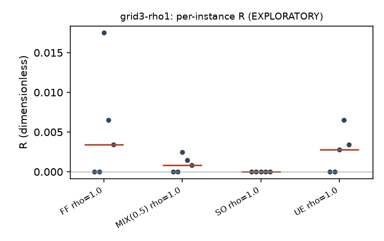

<!-- SPDX-License-Identifier: LicenseRef-FLOW-NC-Research-1.0 -->
# Run report SMOKE-20261124T161549Z-94d06582

**Label: EXPLORATORY.** Exploratory run on exploratory seeds; not a finding and not evidence for any registered hypothesis.

- Experiment id: SMOKE
- Config hash: `94d06582960efcd773fe786bdb9a7b3efed11e0a777d11368b089952dfc1f513`
- Schema: flow.result/1.0.0; records: 26

Generated by `flow report` from `results.json` only.

## Summary by cell, factor level and arm

R = TSTT / TSTT(SO) - 1 is the relative excess total system travel time over the system optimum of the same instance (dimensionless). Status counts: ok / nonconverged / failed. R statistics use only records whose own solve and whose SO reference both converged ('n for R'). Nonconverged and failed runs are counted, not dropped.

| Cell | Factors | Arm | n (ok/nc/fail) | n for R | R median [IQR] | R min to max | mean s | med. iter. |
|---|---|---|---|---|---|---|---|---|
| braess-d6 | demand=6.0, with_link=False | SO | 1 (1/0/0) | 1 | 0.0000 [0.0000, 0.0000] | 0.0000 to 0.0000 | 5.071e-04 | 1 |
| braess-d6 | demand=6.0, with_link=False | FF | 1 (1/0/0) | 1 | 0.3976 [0.3976, 0.3976] | 0.3976 to 0.3976 | 7.258e-05 | 0 |
| braess-d6 | demand=6.0, with_link=False | UE | 1 (1/0/0) | 1 | 0.0000 [0.0000, 0.0000] | 0.0000 to 0.0000 | 3.847e-04 | 1 |
| braess-d6 | demand=6.0, with_link=True | SO | 1 (0/1/0) | 0 | n/a [n/a, n/a] | n/a to n/a | 6.179 | 2.000e+04 |
| braess-d6 | demand=6.0, with_link=True | FF | 1 (1/0/0) | 0 | n/a [n/a, n/a] | n/a to n/a | 9.312e-05 | 0 |
| braess-d6 | demand=6.0, with_link=True | UE | 1 (1/0/0) | 0 | n/a [n/a, n/a] | n/a to n/a | 0.012 | 39 |
| grid3-rho1 | rho=1.0 | SO | 5 (5/0/0) | 5 | 0.0000 [0.0000, 0.0000] | 0.0000 to 0.0000 | 1.011 | 3 |
| grid3-rho1 | rho=1.0 | FF | 5 (5/0/0) | 5 | 0.0034 [0.0000, 0.0065] | 0.0000 to 0.0175 | 2.053e-04 | 0 |
| grid3-rho1 | rho=1.0 | UE | 5 (5/0/0) | 5 | 0.0028 [0.0000, 0.0034] | 0.0000 to 0.0065 | 4.797e-04 | 0 |
| grid3-rho1 | rho=1.0 | MIX(0.5) | 5 (5/0/0) | 5 | 7.951e-04 [0.0000, 0.0015] | 0.0000 to 0.0025 | 4.361e-04 | 0 |

