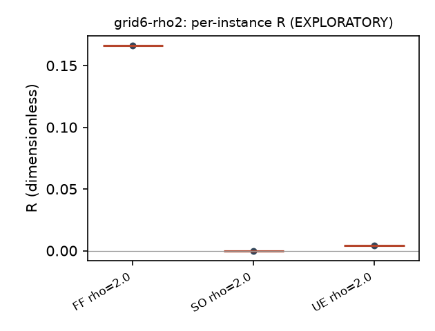

<!-- SPDX-License-Identifier: LicenseRef-FLOW-NC-Research-1.0 -->
# Run report X-SPREAD-6x6-FW-20261124T162957Z-d64cb70a

**Label: EXPLORATORY.** Exploratory run on exploratory seeds; not a finding and not evidence for any registered hypothesis.

- Experiment id: X-SPREAD-6x6-FW
- Config hash: `d64cb70ad40c640f35d930923583da9defced23f3983202c1ffab70c9496f153`
- Schema: flow.result/1.0.0; records: 60

Generated by `flow report` from `results.json` only.

## Summary by cell, factor level and arm

R = TSTT / TSTT(SO) - 1 is the relative excess total system travel time over the system optimum of the same instance (dimensionless). Status counts: ok / nonconverged / failed. R statistics use only records whose own solve and whose SO reference both converged ('n for R'). Nonconverged and failed runs are counted, not dropped.

| Cell | Factors | Arm | n (ok/nc/fail) | n for R | R median [IQR] | R min to max | mean s | med. iter. |
|---|---|---|---|---|---|---|---|---|
| grid6-rho2 | rho=2.0 | SO | 20 (1/19/0) | 1 | 0.0000 [0.0000, 0.0000] | 0.0000 to 0.0000 | 11.330 | 2.000e+04 |
| grid6-rho2 | rho=2.0 | FF | 20 (20/0/0) | 1 | 0.1660 [0.1660, 0.1660] | 0.1660 to 0.1660 | 6.045e-04 | 0 |
| grid6-rho2 | rho=2.0 | UE | 20 (11/9/0) | 1 | 0.0044 [0.0044, 0.0044] | 0.0044 to 0.0044 | 7.794 | 1.753e+04 |

