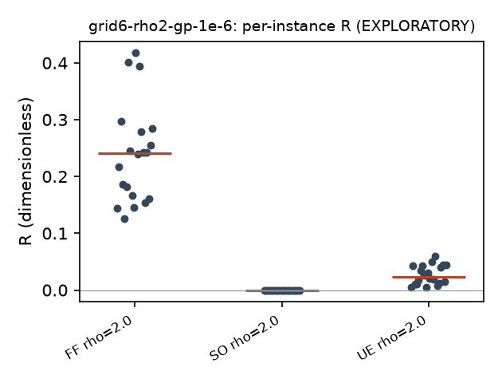
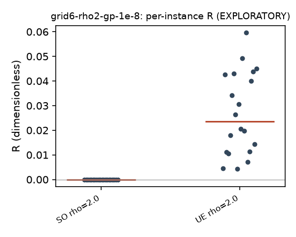

<!-- SPDX-License-Identifier: LicenseRef-FLOW-NC-Research-1.0 -->
# Run report X-SPREAD-6x6-GP-20261124T161651Z-e2c25681

**Label: EXPLORATORY.** Exploratory run on exploratory seeds; not a finding and not evidence for any registered hypothesis.

- Experiment id: X-SPREAD-6x6-GP
- Config hash: `e2c25681480dd1ea5ea57c2767754efbe753d31637635c4fd074bf1f46ba4edd`
- Schema: flow.result/1.0.0; records: 100

Generated by `flow report` from `results.json` only.

## Summary by cell, factor level and arm

R = TSTT / TSTT(SO) - 1 is the relative excess total system travel time over the system optimum of the same instance (dimensionless). Status counts: ok / nonconverged / failed. R statistics use only records whose own solve and whose SO reference both converged ('n for R'). Nonconverged and failed runs are counted, not dropped.

| Cell | Factors | Arm | n (ok/nc/fail) | n for R | R median [IQR] | R min to max | mean s | med. iter. |
|---|---|---|---|---|---|---|---|---|
| grid6-rho2-gp-1e-6 | rho=2.0 | SO | 20 (20/0/0) | 20 | 0.0000 [0.0000, 0.0000] | 0.0000 to 0.0000 | 0.020 | 20 |
| grid6-rho2-gp-1e-6 | rho=2.0 | FF | 20 (20/0/0) | 20 | 0.2409 [0.1648, 0.2798] | 0.1252 to 0.4175 | 5.981e-04 | 0 |
| grid6-rho2-gp-1e-6 | rho=2.0 | UE | 20 (20/0/0) | 20 | 0.0235 [0.0113, 0.0428] | 0.0044 to 0.0596 | 0.008 | 11 |
| grid6-rho2-gp-1e-8 | rho=2.0 | SO | 20 (20/0/0) | 20 | 0.0000 [0.0000, 0.0000] | 0.0000 to 0.0000 | 0.031 | 31 |
| grid6-rho2-gp-1e-8 | rho=2.0 | UE | 20 (20/0/0) | 20 | 0.0235 [0.0113, 0.0428] | 0.0044 to 0.0596 | 0.012 | 18 |

