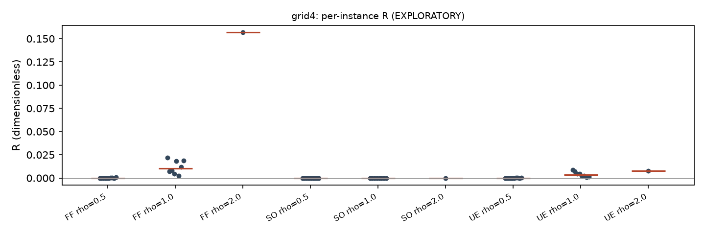

<!-- SPDX-License-Identifier: LicenseRef-FLOW-NC-Research-1.0 -->
# Run report X-TIMING-4x4-20261124T162039Z-2bce20f0

**Label: EXPLORATORY.** Exploratory run on exploratory seeds; not a finding and not evidence for any registered hypothesis.

- Experiment id: X-TIMING-4x4
- Config hash: `2bce20f02d6a08ed5535b0987f0923b0ee66083011c98d69df3a3d21775ee731`
- Schema: flow.result/1.0.0; records: 120

Generated by `flow report` from `results.json` only.

## Summary by cell, factor level and arm

R = TSTT / TSTT(SO) - 1 is the relative excess total system travel time over the system optimum of the same instance (dimensionless). Status counts: ok / nonconverged / failed. R statistics use only records whose own solve and whose SO reference both converged ('n for R'). Nonconverged and failed runs are counted, not dropped.

| Cell | Factors | Arm | n (ok/nc/fail) | n for R | R median [IQR] | R min to max | mean s | med. iter. |
|---|---|---|---|---|---|---|---|---|
| grid4 | rho=0.5 | SO | 10 (10/0/0) | 10 | 0.0000 [0.0000, 0.0000] | 0.0000 to 0.0000 | 0.006 | 0 |
| grid4 | rho=0.5 | FF | 10 (10/0/0) | 10 | 3.189e-07 [0.0000, 5.039e-05] | 0.0000 to 9.451e-04 | 3.044e-04 | 0 |
| grid4 | rho=0.5 | UE | 10 (10/0/0) | 10 | 3.189e-07 [0.0000, 5.039e-05] | 0.0000 to 5.021e-04 | 4.704e-04 | 0 |
| grid4 | rho=1.0 | SO | 10 (8/2/0) | 8 | 0.0000 [0.0000, 0.0000] | 0.0000 to 0.0000 | 3.293 | 3925 |
| grid4 | rho=1.0 | FF | 10 (10/0/0) | 8 | 0.0101 [0.0064, 0.0181] | 0.0023 to 0.0219 | 3.148e-04 | 0 |
| grid4 | rho=1.0 | UE | 10 (10/0/0) | 8 | 0.0035 [0.0019, 0.0053] | 9.883e-04 to 0.0085 | 0.076 | 1 |
| grid4 | rho=2.0 | SO | 10 (1/9/0) | 1 | 0.0000 [0.0000, 0.0000] | 0.0000 to 0.0000 | 8.273 | 2.000e+04 |
| grid4 | rho=2.0 | FF | 10 (10/0/0) | 1 | 0.1567 [0.1567, 0.1567] | 0.1567 to 0.1567 | 3.222e-04 | 0 |
| grid4 | rho=2.0 | UE | 10 (6/4/0) | 1 | 0.0074 [0.0074, 0.0074] | 0.0074 to 0.0074 | 5.226 | 1.746e+04 |
| grid4 | rho=3.0 | SO | 10 (0/10/0) | 0 | n/a [n/a, n/a] | n/a to n/a | 8.664 | 2.000e+04 |
| grid4 | rho=3.0 | FF | 10 (10/0/0) | 0 | n/a [n/a, n/a] | n/a to n/a | 3.183e-04 | 0 |
| grid4 | rho=3.0 | UE | 10 (1/9/0) | 0 | n/a [n/a, n/a] | n/a to n/a | 7.856 | 2.000e+04 |

