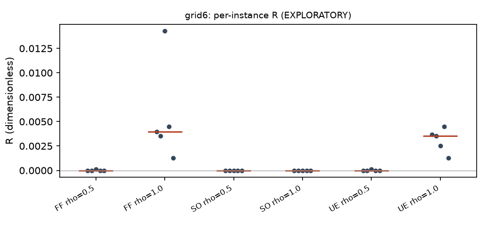

<!-- SPDX-License-Identifier: LicenseRef-FLOW-NC-Research-1.0 -->
# Run report X-TIMING-6x6-20261124T162613Z-5f27dc7d

**Label: EXPLORATORY.** Exploratory run on exploratory seeds; not a finding and not evidence for any registered hypothesis.

- Experiment id: X-TIMING-6x6
- Config hash: `5f27dc7d14b427310ff503fb9cae17587b677a0175d2d36d3143acf2e0d78a22`
- Schema: flow.result/1.0.0; records: 60

Generated by `flow report` from `results.json` only.

## Summary by cell, factor level and arm

R = TSTT / TSTT(SO) - 1 is the relative excess total system travel time over the system optimum of the same instance (dimensionless). Status counts: ok / nonconverged / failed. R statistics use only records whose own solve and whose SO reference both converged ('n for R'). Nonconverged and failed runs are counted, not dropped.

| Cell | Factors | Arm | n (ok/nc/fail) | n for R | R median [IQR] | R min to max | mean s | med. iter. |
|---|---|---|---|---|---|---|---|---|
| grid6 | rho=0.5 | SO | 5 (5/0/0) | 5 | 0.0000 [0.0000, 0.0000] | 0.0000 to 0.0000 | 0.001 | 0 |
| grid6 | rho=0.5 | FF | 5 (5/0/0) | 5 | 0.0000 [0.0000, 0.0000] | 0.0000 to 1.432e-04 | 6.149e-04 | 0 |
| grid6 | rho=0.5 | UE | 5 (5/0/0) | 5 | 0.0000 [0.0000, 0.0000] | 0.0000 to 1.432e-04 | 8.851e-04 | 0 |
| grid6 | rho=1.0 | SO | 5 (5/0/0) | 5 | 0.0000 [0.0000, 0.0000] | 0.0000 to 0.0000 | 0.425 | 533 |
| grid6 | rho=1.0 | FF | 5 (5/0/0) | 5 | 0.0039 [0.0035, 0.0045] | 0.0013 to 0.0143 | 6.264e-04 | 0 |
| grid6 | rho=1.0 | UE | 5 (5/0/0) | 5 | 0.0035 [0.0025, 0.0037] | 0.0013 to 0.0045 | 0.001 | 0 |
| grid6 | rho=2.0 | SO | 5 (0/5/0) | 0 | n/a [n/a, n/a] | n/a to n/a | 11.731 | 2.000e+04 |
| grid6 | rho=2.0 | FF | 5 (5/0/0) | 0 | n/a [n/a, n/a] | n/a to n/a | 6.324e-04 | 0 |
| grid6 | rho=2.0 | UE | 5 (3/2/0) | 0 | n/a [n/a, n/a] | n/a to n/a | 9.429 | 1.928e+04 |
| grid6 | rho=3.0 | SO | 5 (0/5/0) | 0 | n/a [n/a, n/a] | n/a to n/a | 11.825 | 2.000e+04 |
| grid6 | rho=3.0 | FF | 5 (5/0/0) | 0 | n/a [n/a, n/a] | n/a to n/a | 6.390e-04 | 0 |
| grid6 | rho=3.0 | UE | 5 (0/5/0) | 0 | n/a [n/a, n/a] | n/a to n/a | 11.364 | 2.000e+04 |

